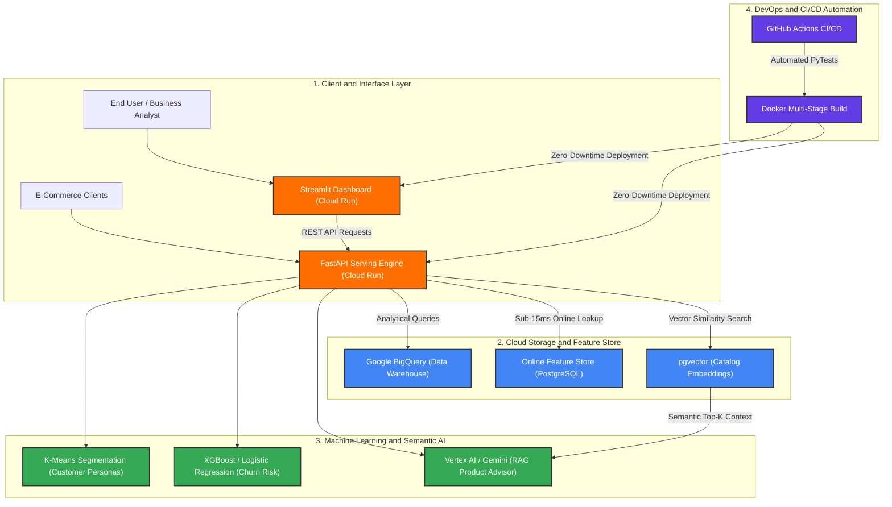

# 🛒 Enterprise E-Commerce Cloud ML & Vector Search Platform

[](https://github.com/Anna9793/ecommerce-data-pipeline/actions)
[](https://www.python.org/downloads/)
[]()
[](https://cloud.google.com/)
[](https://github.com/pgvector/pgvector)
[](https://scikit-learn.org/)
[](https://www.docker.com/)

A production-grade, end-to-end **Cloud Data, Machine Learning, and Semantic Vector Search Platform** built on Google Cloud Platform (GCP). The platform automates customer segmentation, predictive churn scoring, low-latency online feature serving, statistical drift monitoring, and AI-powered product discovery with pgvector.

---

## 🏛️ System Architecture



---

## 🌟 Core Platform Pillars

| Pillar | Category | Description | Key Technologies |
| :---: | :--- | :--- | :--- |
| **01** | **Data Engineering & RFM** | Data preprocessing, outlier detection, and Recency-Frequency-Monetary (RFM) feature calculation. | `Pandas`, `NumPy`, `Scipy` |
| **02** | **Customer Segmentation** | Unsupervised customer persona clustering with K-Means, LogTransforms, and StandardScaler. | `Scikit-Learn`, `KMeans` |
| **03** | **Predictive Churn ML** | Supervised churn prediction modeling with calibrated probabilities and risk scoring. | `LogisticRegression`, `XGBoost` |
| **04** | **Data Warehouse** | Scalable analytical storage for millions of e-commerce transactions and point-in-time time-travel queries. | `Google BigQuery` |
| **05** | **Online Feature Store** | Low-latency (<15ms) key-value feature serving for real-time customer inference. | `PostgreSQL`, `psycopg2.pool` |
| **06** | **Vector Search & RAG** | Conversational product advisor using pgvector embeddings and Google Gemini reasoning. | `pgvector`, `Vertex AI`, `Gemini` |
| **07** | **MLOps & Drift Monitoring** | Automated statistical data drift evaluation using two-sample Kolmogorov-Smirnov (K-S) tests. | `Scipy.stats`, `Plotly` |
| **08** | **Serverless Serving** | Containerized microservices on Cloud Run with zero-downtime model hot-reloading. | `FastAPI`, `Cloud Run`, `Docker` |
| **09** | **CI/CD Quality Gates** | Keyless automated testing and deployment workflow using Workload Identity Federation. | `GitHub Actions`, `Docker Buildx` |

---

## 💻 Interactive Streamlit Dashboard

The platform includes a modern Streamlit web application ([streamlit_app.py](file:///Users/Anna/ecommerce-data-pipeline/streamlit_app.py)) featuring 4 dedicated analytical modules:

1. 📊 **Customer Segmentation**: Interactive 2D/3D PCA visualization of customer clusters with dynamic spending and frequency sliders.
2. 🔮 **Churn Prediction**: Real-time customer churn probability scoring with instant profile lookup from the Online Feature Store.
3. 🛍️ **Product Advisor (RAG & pgvector)**: Conversational shopping assistant with real-time budget filtering and similarity matching.
4. 📈 **Model Monitoring & Drift**: Statistical drift diagnostics comparing live BigQuery distributions against training baselines with BigQuery Time Travel explorer.

---

## 🛠️ Tech Stack

* **Cloud Infrastructure (GCP)**: Google BigQuery, Cloud Run, Cloud Storage, Vertex AI, Artifact Registry.
* **Machine Learning & MLOps**: Scikit-Learn, XGBoost, Scipy (Kolmogorov-Smirnov), MLflow.
* **Vector Database & Feature Store**: PostgreSQL 15, `pgvector` (HNSW indexing), `psycopg2` Threaded Connection Pools.
* **Serving & API**: FastAPI, Uvicorn, Pydantic v2, Streamlit, Plotly.
* **Packaging & DevOps**: `requirements.txt`, Docker Multi-Stage, GitHub Actions CI/CD.

---

## 🚀 Quickstart & Local Execution

### 1. Prerequisites
* Python 3.9+
* Docker & Docker Compose
* Google Cloud SDK (`gcloud`)

### 2. Local Environment Setup
```bash
# Clone repository
git clone https://github.com/Anna9793/ecommerce-data-pipeline.git
cd ecommerce-data-pipeline

# Virtual environment setup
python3 -m venv venv
source venv/bin/activate
pip install -r requirements.txt

# Launch local PostgreSQL (with pgvector) and local services
docker compose up -d
```

### 3. Run Automated Unit Tests (43 Passing)
```bash
pytest tests/
```

### 4. Launch Application
```bash
# Terminal 1: FastAPI Backend
uvicorn app.main:app --host 0.0.0.0 --port 8000 --reload

# Terminal 2: Streamlit Dashboard
streamlit run streamlit_app.py --server.port=8501
```
